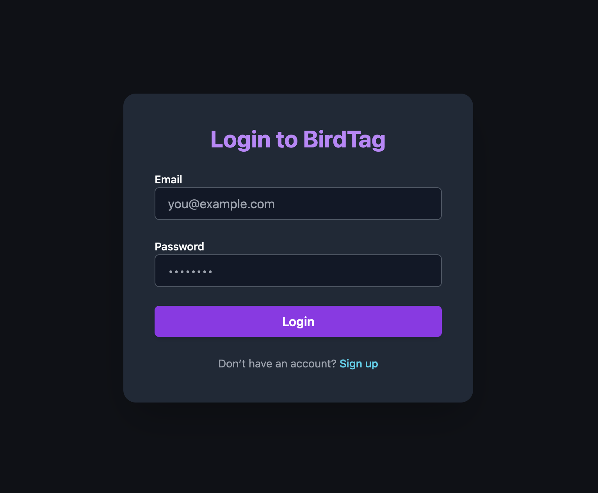
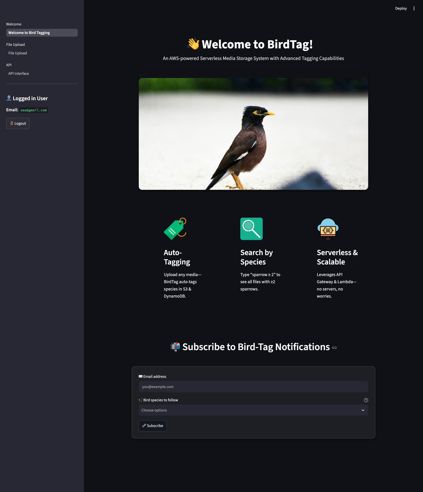
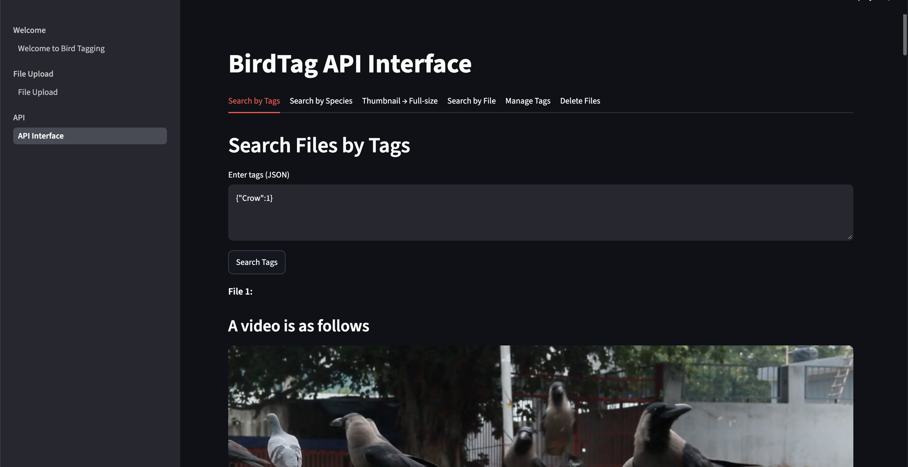
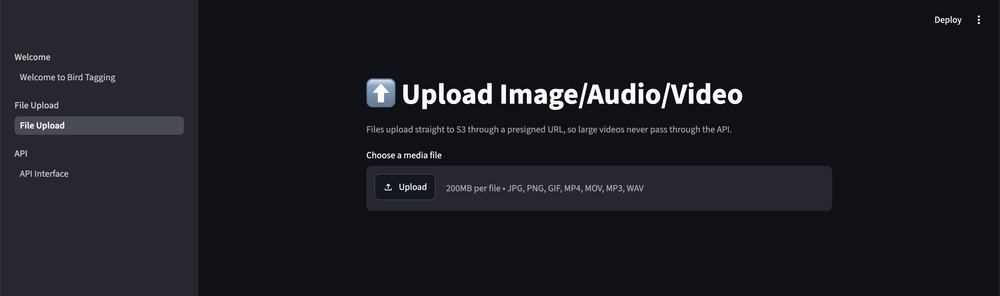
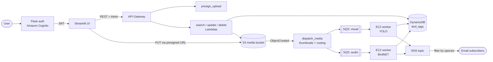

# birds-identifier

**Serverless media storage on AWS that automatically tags bird species in images, video and audio.**

Upload a photo, clip or field recording and birds-identifier works out which birds are in it. A YOLO model handles images and video, BirdNET handles audio, and the results are stored as searchable tags. Subscribers get an email whenever a species they follow shows up.


## Screenshots

### Login



### Welcome



### APIs



### Upload file



## Features

- **Automatic tagging.** Images and video run through a YOLO detector and audio runs through BirdNET. Each file gets a tag map like `{"Crow": 3, "Owl": 1}`.
- **Uploads of any size.** The browser uploads straight to S3 through presigned URLs, so large videos never pass through Lambda or API Gateway.
- **Thumbnails.** Uploaded images get a 300 px JPEG thumbnail, generated with OpenCV in a Lambda layer.
- **Search** by species, by minimum counts (`{"Sparrow": 2}` means at least two sparrows), or by example: upload a file and get back stored media with the same tags.
- **Tag management.** Add or remove tags across many files in one request, and delete files together with their thumbnails and records.
- **Species alerts.** SNS topic subscriptions with per-species filter policies send email notifications.
- **Authentication.** Amazon Cognito user pools handle sign-up, email confirmation and sign-in, and every API call carries a signed token.
- **Hot-reloaded models.** The vision worker checks S3 for new YOLO weights before each job, so the model can be updated without a redeploy.

## Architecture



**Upload and tagging flow**

1. The UI asks `presign_upload` for a URL. The object key is `{image|video|audio}/{id}-{filename}`, so the prefix decides the route and the `id` becomes the record's primary key.
2. The browser uploads the file directly to S3.
3. The S3 event triggers `dispatch_media`. For images it writes `thumbnails/{id}-{filename}`. It then sends the job to the visual or audio SQS queue.
4. A long-polling EC2 worker writes a placeholder record (`isInferenced: false`), downloads the file and runs inference. It then saves the tag counts and publishes one SNS message per detected species.
5. Search-by-file polls until `isInferenced` is true, so the UI can show "still processing" instead of empty results.

The ML workers run on EC2 rather than Lambda because TensorFlow, PyTorch and the model weights are too big for Lambda's deployment limits, and video inference can run past Lambda's timeout. SQS keeps uploads independent of inference throughput.

### Data model

`bird_tags` (DynamoDB, partition key `id`):

| Attribute       | Example                                                                      |
| --------------- | ---------------------------------------------------------------------------- |
| `id`            | `65db63f72b6341688165a76031641bf9`                                           |
| `file_url`      | `https://<bucket>.s3.amazonaws.com/image/65db…-owl_3.jpg`                    |
| `thumbnail_url` | `https://<bucket>.s3.amazonaws.com/thumbnails/65db…-owl_3.jpg` (images only) |
| `tags`          | `{"Owl": 2}`                                                                 |
| `isInferenced`  | `true`                                                                       |

## API

All routes need the `bird-token` header. The `/subscribe` handler and the token authorizer were set up in the AWS console and are not in this repository.

| Method   | Path                                       | Lambda              | Body                                                  | Returns                                         |
| -------- | ------------------------------------------ | ------------------- | ----------------------------------------------------- | ----------------------------------------------- |
| `GET`    | `/presigned-upload?filename=&contentType=` | `presign_upload`    | –                                                     | `presignedUrl`, `s3Key`, `fileUrl`              |
| `POST`   | `/birds/search-tags`                       | `search_by_tags`    | `{"tags": {"Crow": 2}}`                               | files with at least those counts                |
| `POST`   | `/birds/search-species`                    | `search_by_species` | `{"tags": ["Crow", "Owl"]}`                           | files containing all listed species             |
| `POST`   | `/birds/search-thumbnails`                 | `thumbnail_to_full` | `{"url": "<thumbnail url>"}`                          | full-size file URL                              |
| `POST`   | `/birds/search-file`                       | `search_by_file`    | `{"link": "<uploaded file url>"}`                     | files sharing its tags (`202` while processing) |
| `POST`   | `/birds/batch-update`                      | `update_tags`       | `{"urls": [...], "operation": 1, "tags": {"Owl": 1}}` | `1` adds or overwrites, `0` removes             |
| `DELETE` | `/birds`                                   | `delete_files`      | `{"links": [...]}`                                    | removes the S3 objects, thumbnails and records  |
| `POST`   | `/subscribe`                               | –                   | `{"email": "...", "tags": ["Owl"]}`                   | subscribes an email to species alerts           |

## Tech stack

| Layer     | Technology                                                                         |
| --------- | ---------------------------------------------------------------------------------- |
| Frontend  | Streamlit, Flask, Tailwind CSS                                                     |
| Auth      | Amazon Cognito, JWT                                                                |
| API       | Amazon API Gateway, AWS Lambda (Python 3.12)                                       |
| Storage   | Amazon S3, Amazon DynamoDB                                                         |
| Messaging | Amazon SQS, Amazon SNS                                                             |
| Inference | Amazon EC2, Ultralytics YOLO + Supervision (image/video), BirdNET-Analyzer (audio) |
| Imaging   | OpenCV (headless, as a Lambda layer)                                               |

## Run the UI locally

Demo mode runs the full UI against `frontend/mock_api.py`, a local stand-in that returns the same responses as the Lambdas. It needs no AWS account, and any email and password will sign in.

```bash
python3 -m venv .venv
source .venv/bin/activate
pip install -r frontend/requirements.txt
python frontend/run.py
```

This opens <http://localhost:8500>. Put some media in `demo/media/` first, named by species (for example `owl_1.jpg`, `crow_2.jpg`, `kingfisher.mp4`). In demo mode tags come from the filenames instead of the models.

To point the UI at a real deployment, copy `.env.example` to `.env`, set `DEMO_MODE=0`, and fill in the API Gateway and Cognito values.

## Deploying the backend

<details>
<summary>AWS setup</summary>

1. **S3:** create a media bucket and send `ObjectCreated` events for the `image/`, `video/` and `audio/` prefixes to `dispatch_media`.
2. **OpenCV layer** for `dispatch_media`:
   ```bash
   pip install opencv-python-headless numpy --platform manylinux2014_x86_64 \
       --only-binary=:all: --python-version 3.12 -t layer/python
   cd layer && zip -r ../opencv-layer.zip python
   ```
3. **DynamoDB:** create the table `bird_tags` with partition key `id` (String).
4. **SQS:** create one queue for visual jobs and one for audio jobs.
5. **SNS:** create a topic. Subscriptions use a filter policy on the `tag` message attribute.
6. **Lambdas** in `lambdas/`. Environment variables:

   | Variable                              | Used by                                            |
   | ------------------------------------- | -------------------------------------------------- |
   | `MEDIA_BUCKET`                        | `presign_upload`, `search_by_file`, `delete_files` |
   | `TABLE_NAME` (default `bird_tags`)    | search, update and delete functions                |
   | `VISUAL_QUEUE_URL`, `AUDIO_QUEUE_URL` | `dispatch_media`                                   |

7. **Workers** on EC2 (`workers/visual`, `workers/audio`). Run `pip install -r requirements.txt` (or `setup.sh` for audio), then `python inference_worker.py` or `python audio_worker.py`. Set `TABLE_NAME`, `QUEUE_URL`, `SNS_TOPIC_ARN` and `AWS_REGION`. The visual worker also needs `MODEL_BUCKET` and `MODEL_KEY`, which point to the YOLO weights (`.pt`) in S3. The weights are not in this repository. Any Ultralytics model whose class names are the species labels will work.
8. **API Gateway:** create the routes in the table above. `presign_upload` uses Lambda proxy integration. The `/birds/*` routes pass the JSON body straight to the handler.
9. **Cognito:** create a user pool app client with a client secret and the `USER_PASSWORD_AUTH` flow enabled.

</details>

## Project structure

```
├── lambdas/            # API and S3-triggered Lambda handlers
├── workers/
│   ├── visual/         # SQS worker: YOLO image/video tagging
│   └── audio/          # SQS worker: BirdNET audio tagging
├── frontend/
│   ├── auth/           # Flask + Cognito sign-up / sign-in
│   ├── streamlit_app/  # Dashboard, upload and API pages
│   ├── mock_api.py     # Local stand-in for the backend (demo mode)
│   └── run.py          # Starts everything
└── demo/media/         # Your sample media for demo mode (git-ignored)
```

## Design notes and next steps

- **Scans over queries.** Searches use DynamoDB `scan`, which is simple and fine for a few thousand items. At larger scale a tag-to-file index table (or OpenSearch) would replace it.
- **Idempotent processing.** Records are keyed by the upload id, so a reprocessed SQS message overwrites the same item instead of duplicating it. A dead-letter queue for failed jobs would be the next hardening step.
- **Missing infrastructure as code.** The stack was assembled in the console. A SAM or CDK template would be the next step.

## Contributors

- **Yu-Ching Kuo**: backend. Serverless API, media pipeline, SQS/SNS messaging, inference workers.
- **Chun-Heng Chien**: backend. Vision inference, thumbnail dispatch, search and tagging APIs.
- **Vallabh Shelar**: frontend. Streamlit UI and presigned uploads.
- **Akash**: authentication. Cognito integration and API tokens.

## Acknowledgements

- [BirdNET-Analyzer](https://github.com/birdnet-team/BirdNET-Analyzer) by the K. Lisa Yang Center for Conservation Bioacoustics. Its model weights are licensed under CC BY-NC-SA 4.0.
- [Ultralytics YOLO](https://github.com/ultralytics/ultralytics) and [Supervision](https://github.com/roboflow/supervision). `birds_detection.py` is adapted from a reference YOLO and Supervision inference script.

## License

[MIT](LICENSE). Third-party models and libraries keep their own licenses.
